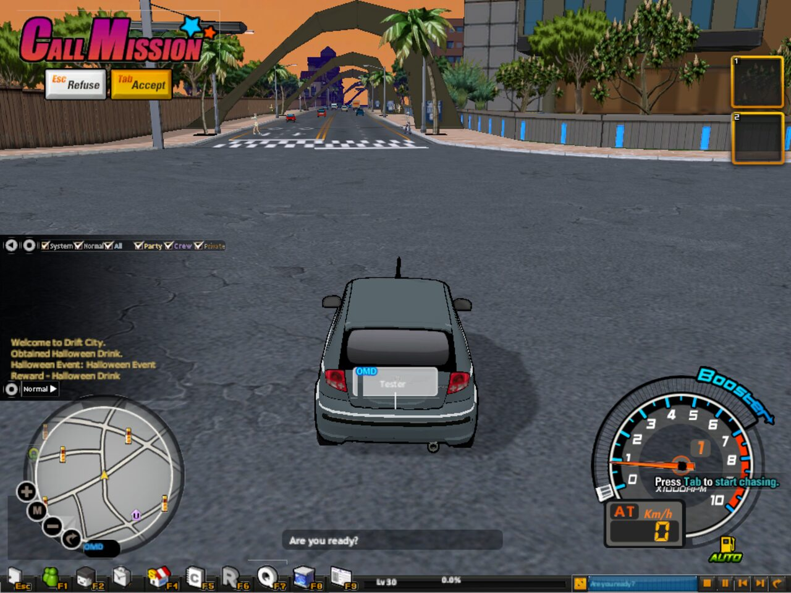

# Drift City Rebuild

A from-scratch rebuild of the online racing game **Drift City** in Unity, written by reverse-engineering the
original `DriftCity.exe` function by function, plus its own game server.

> **This repository contains no game content.** No models, textures, sounds, music, interface art, data tables or
> executables. You need your own installed copy of the Drift City client: the rebuild reads every original file
> from it while it runs and never modifies it.

**Website:** https://magicibrar.github.io/driftcity-unity/



## Status

About **94%** of the game's own code is converted (by size of the original code, after leaving out libraries and
platform services the rebuild replaces on purpose). 3,032 functions are studied and cited in the notes, and 295 of the
384 dialogs the exe drives are rebuilt from the original layouts. It has 85 Unity play tests and 125 server tests.
The [code map](DriftCity_RE/CODEMAP.md) has the per-subsystem breakdown.

Playable offline on your own or online on a server you host: the open cities (Moon Palace, Koinonia, Cras, Oros), traffic
and HUV chases, the Battle Zone races and crew Channel Battles, the Undercity, missions and the storyline, the car show
room, custom shop, parts, inventory, trade and auction, parties, friends, crews and chat, and the seasonal events.

## Point it at your game

You need the installed client: the folder that contains `DriftCity.exe` and `Data` (with `Init.agt`, `World.agt` ...).
The client finds it in this order:

1. `-gameRoot "C:\Games\Drift City"` on the command line
2. the `DRIFTCITY_ROOT` environment variable
3. `gameroot.txt` next to the player exe (in the editor: in `DriftCityOffline/`, next to `Assets`) holding that path

The archives (`.agt`, `Patch\Patch.*`) are mounted and read directly. Optionally, **Drift City → Import Game Data
Into Project** unpacks them into `DriftCityOffline/GameData` for faster loading; that folder is git-ignored and stays
on your machine.

## Build and run the client

1. Install **Unity 6000.4.2f1**.
2. Clone this repository and open `DriftCityOffline` in Unity Hub.
3. Create `DriftCityOffline/gameroot.txt` containing your game path.
4. Open `Assets/Scenes/DriftCityGame.unity` and press Play, or build with **Drift City → Build Windows Player**
   (output in `DriftCityOffline/Build/DriftCityOffline`). Put a `gameroot.txt` next to the built exe as well.

```
git clone https://github.com/MagicIbrar/driftcity-unity.git
```

## Host the server (online play)

Only needed to play online.

1. Install **Node.js 22.5** or newer.
2. In `DriftCityServer`: `npm install`, then put your game path into `DriftCityServer/gameroot.txt` (or set
   `DRIFTCITY_ROOT`).
3. `npm start` (or `start-server.bat`). On the first start it reads the tables it needs from your game's archives
   into `DriftCityServer/gamedata` (git-ignored), then listens on port 7860. To redo that step:
   `node tools/extract-gamedata.js "C:\Games\Drift City"`.
4. Players pick **This PC**, or add `Name|ws://HOST:7860` to `servers.txt` next to the client.

`npm test` runs the server tests; `node tools/bot.js 3` starts three test drivers.

The server is not the original one and does not speak its protocol: it is a new JSON-over-WebSocket server made for
this rebuild, authoritative for money, rewards and items.

## Layout

| Folder | What it is |
| --- | --- |
| `DriftCityOffline` | The Unity client: file system and format readers (NayaPack, NIF, DDS, NUI, XLT/TDF), world, cars, UI, game modes, tests |
| `DriftCityServer` | The Node.js game server (own protocol), its tests and the game-data extractor |
| `DriftCity_RE` | Reverse-engineering notes with exe addresses, the opcode list and the code map |
| `DriftCityStaging` | A small .NET harness used while studying formats |
| `docs` | The project website (GitHub Pages) |

## Contributing

Pull requests with code are welcome. Never commit game files or anything extracted from them; the `.gitignore`
blocks the usual formats and the data folders.

## Legal

A non-commercial fan project for preservation and study. It is not affiliated with or endorsed by the game's
developer, publisher or the Hangame portal. Drift City and all related names are trademarks of their owners. The
source code is released under the [MIT licence](LICENSE); the game and all of its content remain the property of their
owners and are not distributed here.
